# 🤖 Telegram Bot SMS & SMM Store

A complete Telegram bot solution for selling virtual phone numbers (SMS) and Social Media Marketing (SMM) services, with integrated payment processing.

The bot sources its numbers and SMM services from an external API and uses the **Fatoorah** payment gateway to handle transactions, providing a seamless buying experience for users directly within Telegram.

## ✨ Features

- 📱 **SMS Number Sales** — Sell virtual phone numbers sourced from an external API.
- 📈 **SMM Services** — Offer Social Media Marketing services from an external API.
- 💳 **Fatoorah Payment Gateway** — Integrated payment processing for secure and reliable transactions.
- 🤖 **Full Telegram Integration** — Complete bot functionality for browsing, purchasing, and managing orders.
- 🔄 **API-Powered** — Dynamically fetches available SMS and SMM products from a backend API.
- ⚙️ **End-to-End Sales Flow** — Handles product selection, checkout, payment, and order fulfillment.
- 🛒 **Automated Storefront** — A self-contained store for selling digital services.

## 📸 Screenshots

*Bot screenshots*

  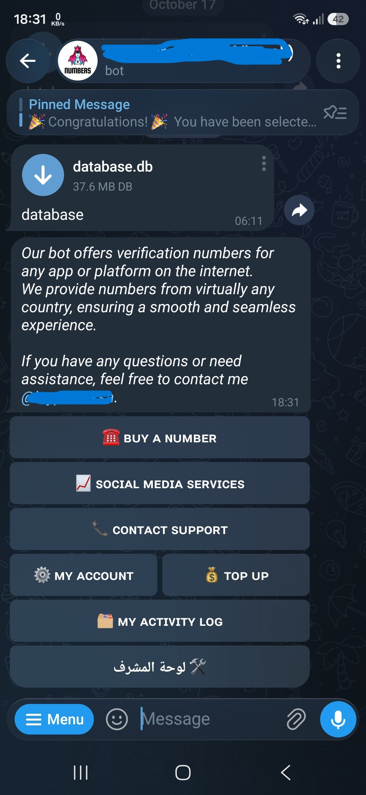
  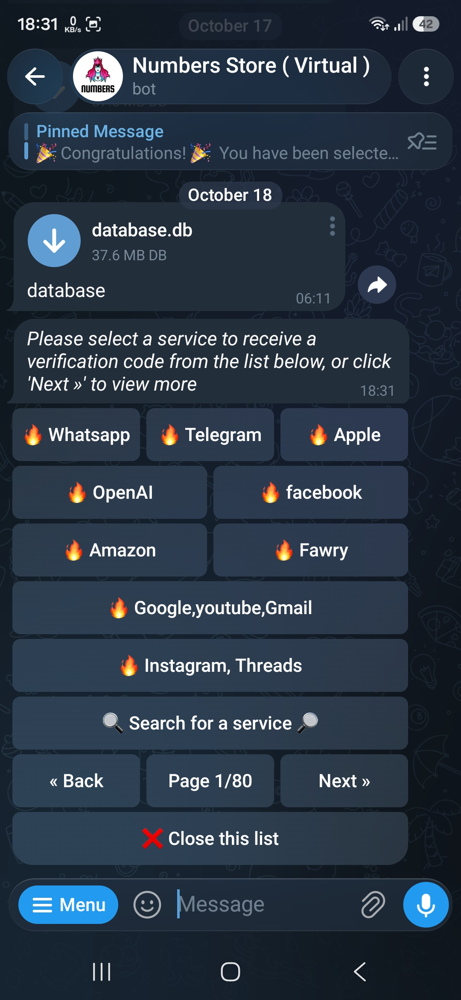
  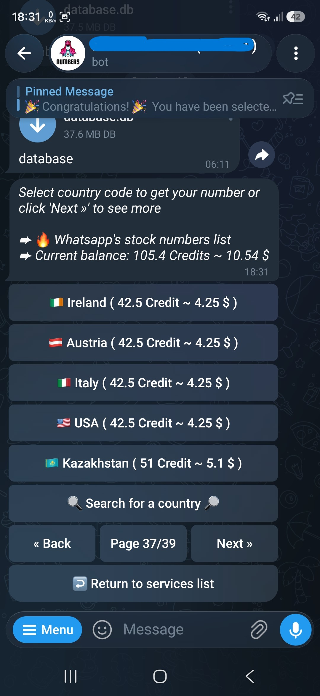

  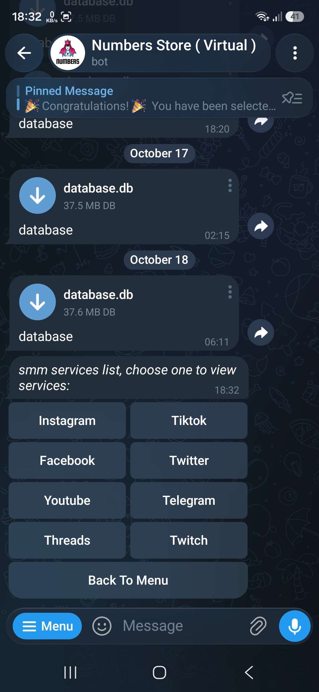
  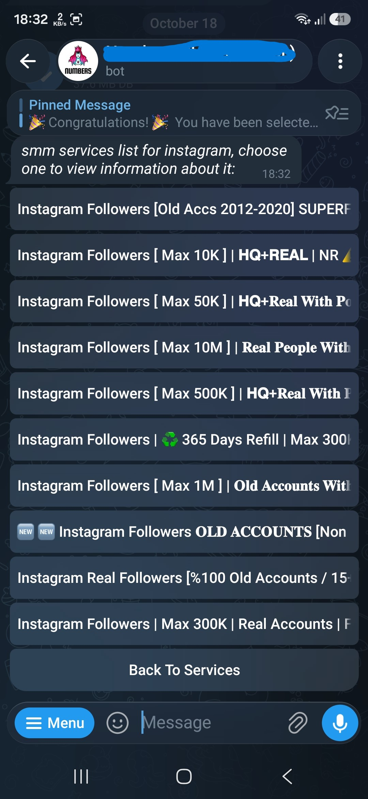
  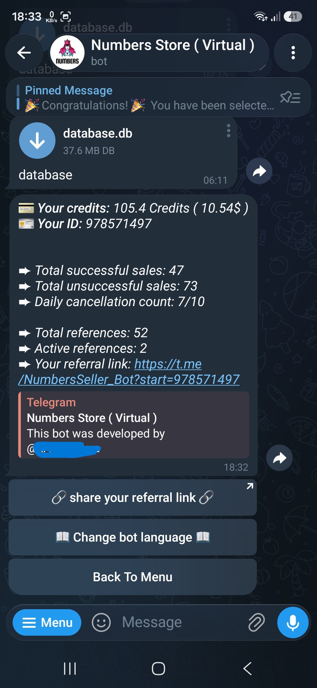

  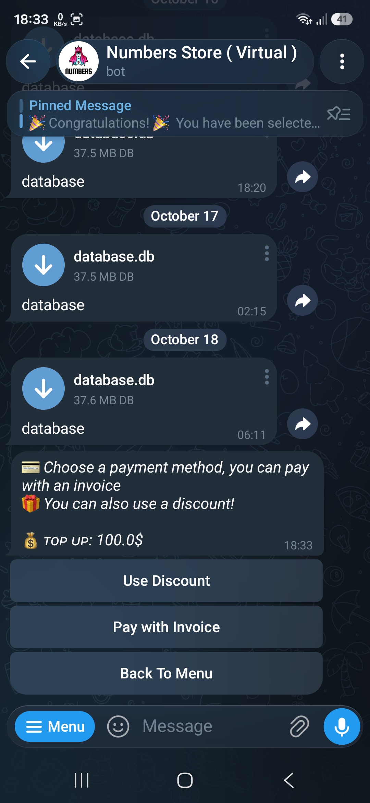
  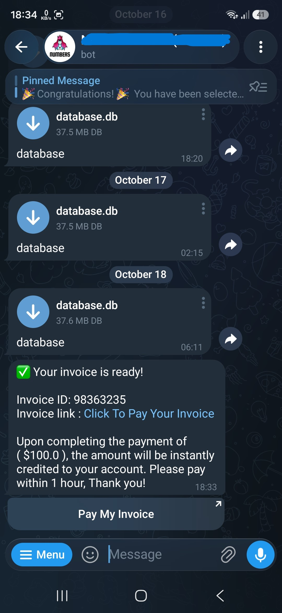
  

  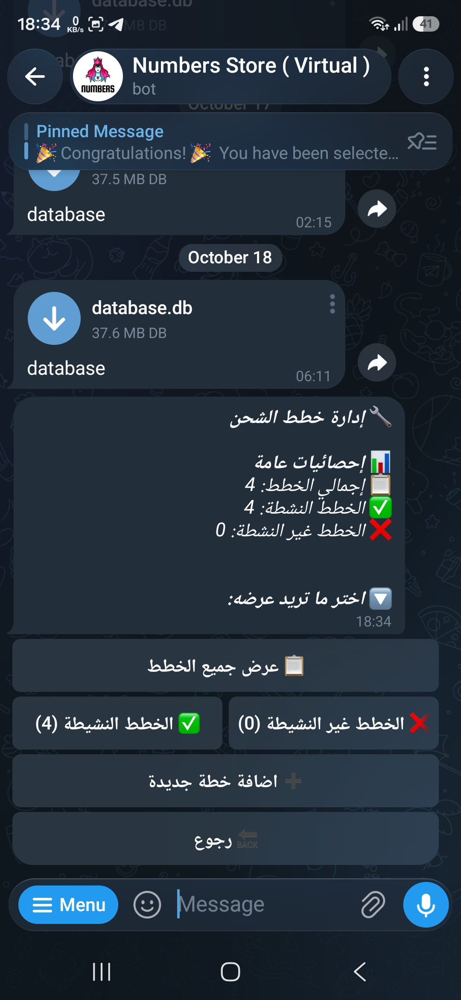
  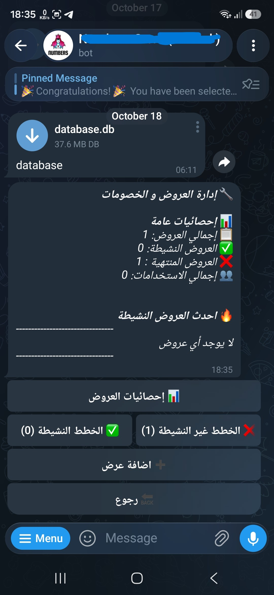
  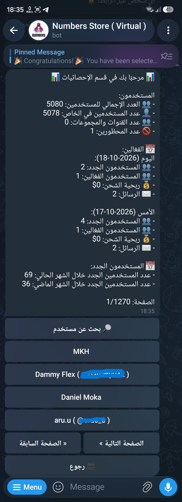

  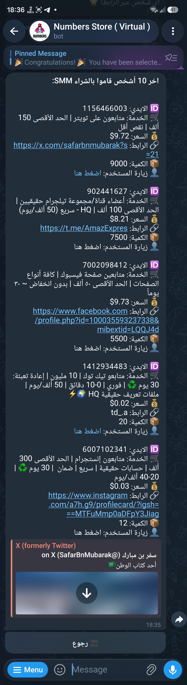
  
  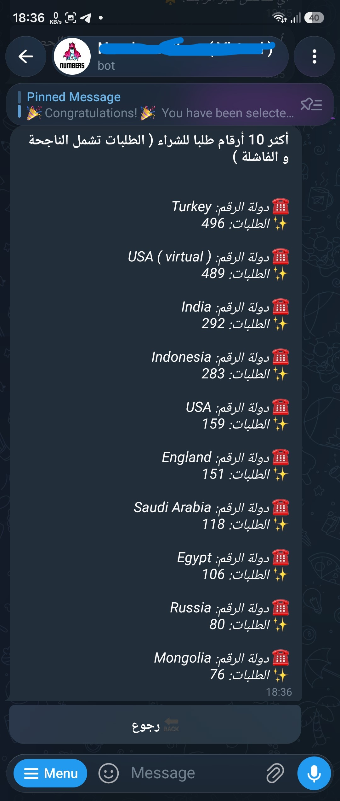

  
  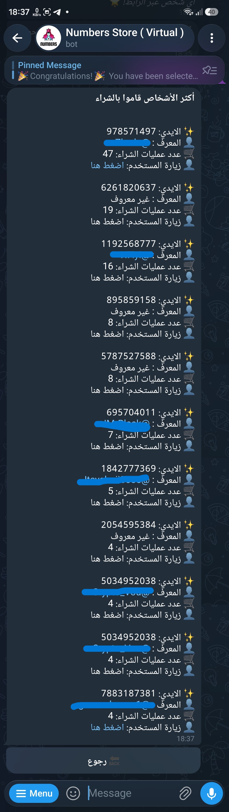

